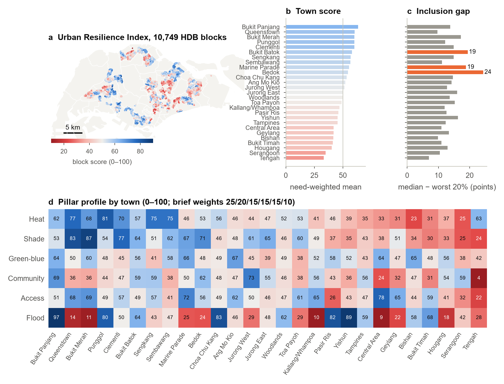
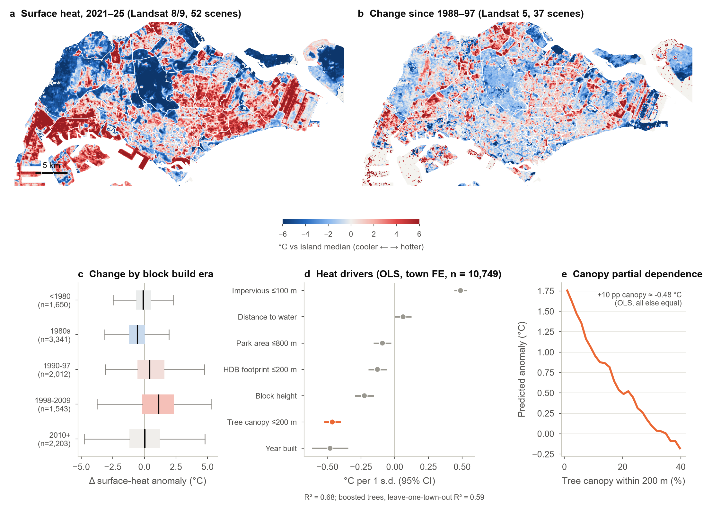

# Urban Resilience Index: who does a plan cool?

**A block-level heat-resilience and inclusion index for Singapore's public housing, built entirely from open data, with a community-data loop and a business model that turns mandatory greenery into measurable returns.**

[**Live site →**](https://urban-resilience-index.nilikun.workers.dev) · [Concept brief](docs/concept-brief.md) · [Methods](docs/METHODS.md) · [Data](docs/DATA.md)



## Abstract

Singapore's towns are getting hotter, yet the residents most at risk get the least protection. About half of 400+ HDB flats in a recent study were hotter inside than outdoors, and most rental flats lack air-conditioning. Planning tools model wind, sun and temperature well, but not *who* a plan cools. Greenery rules count leaves, not beneficiaries, and the Green Plan 2030 sets no heat target.

We operationalise the concept brief in [`docs/concept-brief.md`](docs/concept-brief.md) as a working pipeline:

1. **The index.** Every one of **10,749 HDB blocks** (99.4% of residential blocks) is scored 0–100 on six pillars: heat, shade, green-blue space, community, access and flooding. The inputs are 89 Landsat scenes, Sentinel-2 imagery, a 16,087 km OpenStreetMap walking network with shade on every edge, and 16 data.gov.sg datasets plus PUB's flood-prone list. Vulnerability (seniors, rental households, older blocks) weights each block rather than being a pillar, and every town reports an **inclusion gap**: the median block minus the mean of the worst-served 20%.
2. **Community data.** A credit system for verified resident actions, led by rooftop farms (kg harvested). It validates the model and re-learns its weights, providing the post-occupancy evidence open data cannot.
3. **How people pay.** A project pass for developers of Government Land Sales sites. It is tested on an anonymised 2023 Woodlands GLS condominium with a Gurobi mixed-integer model and a 20,000-draw Monte Carlo.

## Key findings

| | Finding |
|---|---|
| **Heat history** | Estates cool as trees mature. Relative to each scene's island median, 1980s blocks are now cooler than in 1988–97, while blocks built 1998–2009 warmed most (median +1.1 °C). |
| **Strongest lever** | Holding town, imperviousness, height and age fixed, **+10 pp tree canopy within 200 m ≈ −0.48 °C** surface heat (OLS R² 0.68, town FE). Gradient-boosted trees predict an unseen town with R² 0.59. |
| **Inequity inside towns** | Inclusion gaps range from 7 to 24 points. Bedok (24), Bukit Batok (19) and Marine Parade (19) have good averages but leave their worst-served blocks far behind. |
| **The inclusion check changes the answer** | In Woodlands, six tweaks ranked by town average lift the score +2.1 but **widen** the gap (13.6 → 14.5). Ranked for the worst-served 20% as well, the same pool lifts the score +1.6 and **narrows** the gap (13.6 → 13.3). |
| **The market does not price cooling yet** | In 73,304 HDB resale transactions (2024–26), block-level canopy carries no premium within town and month, while MRT distance is priced strongly. Value has to come from verified data that unlocks finance, which is why the business model leads with sustainability-linked loans, not sale premia. |
| **Developer case** | Under identical URA greenery rules (GnPR 3.5): **−41% 30-year greenery cost**, upkeep S$35 → S$16 per unit per month, and **898 seniors and rental households** within 200 m of a public cool refuge (best naive placement: 712). The net gain vs a typical showcase design is **+S$2.1M per site (P50)**, positive in 100% of 20,000 draws. |
| **Robustness** | Town ranks hold under stakeholder weight lenses (Spearman 0.80–0.97) and 2,000 Dirichlet weightings. The shade penalty (α = 0 → 1) moves no town more than 0.6 points. |



## The index

| Pillar | Weight | Indicators (all block-level) | Source | Confidence |
|---|---|---|---|---|
| Heat exposure | 25 | Median surface-heat anomaly within 100 m, 2021–25 | Landsat 8/9 C2 L2 (52 scenes) | high |
| Shade & cooling | 20 | Tree canopy within 200 m (NDVI > 0.6); shaded share of walkways within 400 m | Sentinel-2 L2A; OSM covered ways + canopy | medium |
| Green-blue space | 15 | Network walk to nearest park; park area within 800 m; distance to park connector / water | NParks, URA, OSM | high |
| Community & green use | 15 | Community in Bloom gardens within 400 m (*proxy until resident reports exist*) | NParks | low |
| Access & mobility | 15 | **Heat-adjusted** walks to eldercare/AAC, CHAS clinic, hawker centre, MRT exit, bus stop | MOH, NEA, LTA, OSM | high |
| Flood resilience | 10 | Distance to PUB flood-prone locations (Nov 2025 list, geocoded) | PUB, OneMap | medium |

```
indicator → percentile 0–100 across all HDB blocks (flipped where lower is better)
pillar    = mean(indicators)
block     = Σ w·pillar / Σ w
need      = (seniors + 1.5·rental households) × 1.3 if built before 1990
town      = Σ need·block / Σ need
inclusion = median(block) − mean(worst 20% of blocks)
```

**Five tests for every input** (from the brief): evidence, plannable, block-level open data, not redundant (|ρ| ≤ 0.8), predictive. During the build, NEA WBGT **failed test 3**: 27 stations cannot resolve blocks, and interpolated WBGT correlates with satellite surface heat at ρ = −0.05. It is kept as a live context layer, not scored.

## Reproduce

```bash
pip install -r requirements.txt
python run_all.py                 # everything, in order (≈1–2 h first run; downloads are cached)
python run_all.py --from index    # re-score from cached data
```

* Satellite data is read from the [Microsoft Planetary Computer](https://planetarycomputer.microsoft.com) (no account needed). The first run downloads about 1.4 GB of scene windows to `data/satellite/`.
* The developer case needs [`gurobipy`](https://www.gurobi.com/academia/) with an academic licence. Everything else is open source.
* Python 3.11. Windows users: set `PYTHONUTF8=1`.
* Website: `cd web && python -m http.server`, then open <http://localhost:8000>. Deploy with `npx wrangler deploy` (static assets, see [`wrangler.jsonc`](wrangler.jsonc)).

## Repository layout

```
uri/                  the index pipeline
  fetch.py            data.gov.sg downloads (16 datasets)
  osm.py              OpenStreetMap walking network (Overpass or BBBike extract)
  wbgt.py             NEA WBGT history (context layer)
  satellite.py        Landsat LST (single-channel, NDVI emissivity) + Sentinel-2 composites
  blocks.py           block table, street-code matching, Census need weights
  network.py          shade per edge, heat-adjusted multi-source Dijkstra
  index.py            indicators → pillars → scores, towns, inclusion gap
  analysis.py         benchmarks, heat drivers, heat history, value lens, robustness
  tweaks.py           tweak engine (green pockets, rooftop farms, shaded walkways)
  figures.py          paper figures
  export_web.py       website data and map overlays
case_gls_site/        developer case: Gurobi MILP + Monte Carlo (anonymised site)
scripts/              geocoding helpers (PUB flood list, OneMap)
figures/              Figures 1–5 (PNG 300 dpi + PDF)
docs/                 concept brief, methods, data sources
web/                  static website (MapLibre GL, vanilla JS)
```

## Limitations

* NDVI > 0.6 at 10 m approximates tree canopy and cannot separate trees from dense shrubs. Building shade is not modelled, and covered-walkway shade depends on OSM completeness.
* Surface temperature is not air temperature or felt heat. Indoor heat and block-level WBGT are phase 2.
* Seniors per block come from Census 2020 subzone shares. Tengah had no residents in 2020 and uses the island median.
* Flood resilience uses one geocoded point per named PUB location, a coarse proxy.
* Heat drivers and the value lens are associations, not causal effects. The developer case uses benchmarked assumptions, each tagged in [`case_gls_site/src/params.py`](case_gls_site/src/params.py).
* The Community pillar is a proxy. The resident-reporting loop is a proposal, not yet a dataset.

## Data and licences

Contains information from data.gov.sg accessed October 2026, made available under the [Singapore Open Data Licence v1.0](https://data.gov.sg/open-data-licence). Landsat imagery courtesy of the U.S. Geological Survey. Contains modified Copernicus Sentinel data (2024–2025). Map data © OpenStreetMap contributors (ODbL). Basemap © OneMap / Singapore Land Authority. Photographs are from Wikimedia Commons under the licences listed in [`web/assets/img/photos/credits.json`](web/assets/img/photos/credits.json). Full list: [`docs/DATA.md`](docs/DATA.md).

Code: MIT licence. Text and figures: CC BY 4.0.

*An independent research prototype, not affiliated with or endorsed by any government agency or developer. Scores describe neighbourhood conditions from open data and are not property valuations.*
