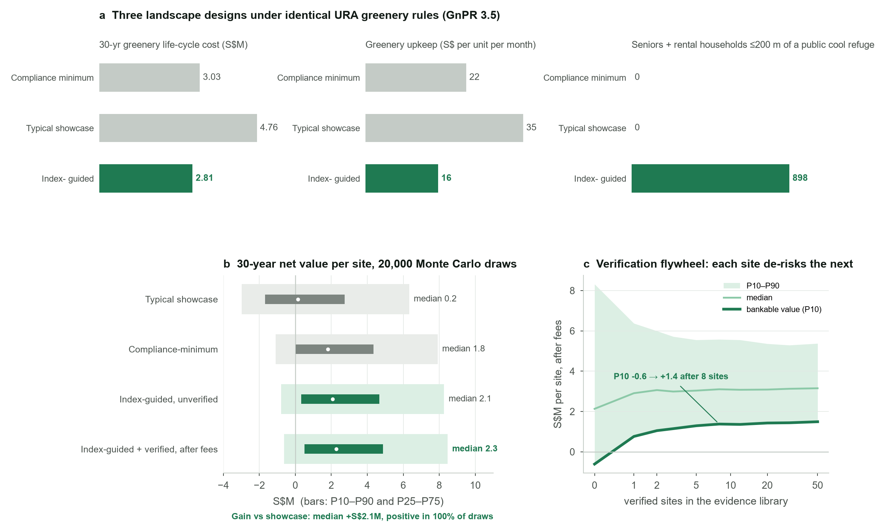

<p align="center"></p>

<h1 align="center">UrbanPulse</h1>
<p align="center"><b>Who does a plan cool?</b><br>A block-level heat-resilience and inclusion index for Singapore's public housing, with a community-data loop and a business model that turns mandatory greenery into verifiable returns.</p>

<p align="center"><a href="docs/concept-brief.md">Concept brief</a> · <a href="docs/METHODS.md">Methods</a> · <a href="docs/DATA.md">Data</a> · <a href="web/">Website</a></p>


## Abstract

URA requires new private flat and condominium developments to provide greenery equal to **30–40% of their site area**, yet no one can say *who that greenery cools*. In a recent study of 400+ HDB flats, about half were hotter inside than outdoors. Seniors and rental households have the least protection, and today's planning tools do not see them.

**UrbanPulse** scores all **10,749 HDB blocks** (99.4% of residential blocks) on six pillars: heat, shade, green-blue space, community, access and flooding. The pillars are built from 89 Landsat scenes, Sentinel-2 imagery, a 16,087 km OpenStreetMap walking network mapped for shade, and 16 data.gov.sg datasets, and are weighted by where seniors and rental households live. Three findings stand out:

* Town averages hide **inclusion gaps of up to 24 points** between typical and worst-served blocks.
* Tree canopy is the strongest plannable lever: +10 percentage points goes with about 0.5 °C cooler surfaces.
* Checking inclusion **changes which design tweaks a planner should pick**.

Resale prices do not reward cooling yet, so its value has to be proven. UrbanPulse closes that loop after handover. Residents and Active Ageing Centres earn credits for verified outcomes, led by kilograms harvested on rooftop farms, and that evidence lets developers meet sustainability-linked loan targets. On an anonymised 2023 Woodlands GLS site, under identical URA rules, the index-guided design cuts 30-year greenery cost by **41%** and adds a median **S$2.1M per site**.

## Why it matters

| For | What UrbanPulse gives | Evidence in this repo |
|---|---|---|
| **Residents** | Plans scored on who they cool; seniors and rental households weighted, never marked down | 898 seniors + rental households within 200 m of a new public cool refuge at one GLS site (best naive siting: 712) |
| **Planners** | Block-level scores, an inclusion gap on every plan, design targets from towns that worked | 27 towns benchmarked; Bedok's 24-point gap hidden behind an average score |
| **Developers** | A project pass that turns mandatory greenery into returns | −41% 30-year greenery cost; upkeep S$35 → S$16 per unit per month |
| **Lenders** | Verified post-occupancy KPIs for sustainability-linked loans | Bankable (P10) value per site rises from −S$0.6M to +S$1.4M after 8 verified sites |

**What is new.** Existing tools model physics: wind, sun and temperature (e.g. HDB/A\*STAR's Integrated Environmental Modeller). Greenery rules count leaf area. UrbanPulse adds three things:
* the **people and equity layer**: who benefits, block by block;
* a **post-handover data loop**: residents verify outcomes and are paid for taking part, never for the answer;
* a **finance link**: verified data unlocks loan step-downs and lower upkeep.

The data moat compounds with every verified site.

## Key findings

| | Finding |
|---|---|
| **Heat history** | Estates cool as trees mature. Relative to each scene's island median, 1980s blocks are cooler now than in 1988–97; blocks built 1998–2009 warmed most (median +1.1 °C). |
| **Strongest lever** | Holding town, imperviousness, height and age fixed, **+10 pp canopy within 200 m ≈ −0.48 °C** (OLS R² 0.68, town FE). Gradient-boosted trees predict an unseen town with R² 0.59. |
| **Inequity inside towns** | Inclusion gaps run from 7 to 24 points. Bedok (24), Bukit Batok (19) and Marine Parade (19) leave their worst-served blocks far behind. |
| **Inclusion changes the answer** | In Woodlands, six tweaks ranked by average lift the score +2.1 but **widen** the gap (13.6 → 14.5). Ranked for the worst-served 20% as well, the same candidates lift it +1.6 and **narrow** the gap (13.6 → 13.3). |
| **Market does not price cooling** | In 73,304 HDB resale transactions (2024–26), block-level canopy carries no premium within town and month, while MRT distance is priced strongly. So the business case leads with finance, not sale premia. |
| **Developer case** | Under identical URA rules, the index-guided design gains a median +S$2.1M per site vs a typical showcase, positive in 100% of 20,000 Monte Carlo draws. |
| **Robustness** | Town ranks hold under stakeholder weight lenses (Spearman 0.80–0.97) and 2,000 random weightings. The shade penalty (α 0 → 1) moves no town more than 0.6 points. |


## Business model

| Customer | Product | Indicative price* |
|---|---|---|
| Developers, starting with Government Land Sales sites | Project Pass: neighbourhood scoring, URA greenery compliance, tweaks, return calculator | S$80k per site |
| Developers and lenders | Monitoring: verified post-occupancy KPIs for sustainability-linked loans and ESG reporting | S$36k a year × 5 |
| Owners of existing buildings | Retrofit monitoring (Skyrise Greenery Incentive co-funds existing buildings) | S$15k a year |
| Planners and agencies | Seats or annual licence | by tender |
| Residents and AACs | Credits funded by part of revenue | — |

*Illustrative assumptions used in the model, not quotes. Market context:
* URA's 2026 Confirmed Lists carry 9,320 GLS units.
* Developer sustainability-linked loans already carry nature targets, e.g. the [CDL–DBS S$300M SLL (2026)](https://www.cdl.com.sg/newsroom/cdl-and-dbs-launch-s-300-million-multi-currency-sustainability-linked-loan-to-advance-nature-based-urban-development-solutions-in-singapore) with microforest and urban-farming KPIs.



## The index

| Pillar | Weight | Indicators (all block-level) | Source | Confidence |
|---|---|---|---|---|
| Heat exposure | 25 | Median surface-heat anomaly within 100 m, 2021–25 | Landsat 8/9 C2 L2 (52 scenes) | high |
| Shade & cooling | 20 | Tree canopy within 200 m (NDVI > 0.6); shaded share of walkways within 400 m | Sentinel-2 L2A; OSM covered ways + canopy | medium |
| Green-blue space | 15 | Network walk to nearest park; park area within 800 m; distance to park connector / water | NParks, URA, OSM | high |
| Community & green use | 15 | Community in Bloom gardens within 400 m (*proxy until resident reports exist*) | NParks | low |
| Access & mobility | 15 | **Heat-adjusted** walks to eldercare/AAC, CHAS clinic, hawker centre, MRT exit, bus stop | MOH, NEA, LTA, OSM | high |
| Flood resilience | 10 | Distance to PUB flood-prone locations (Nov 2025 list, geocoded) | PUB, OneMap | medium |

```
indicator → percentile 0–100 across all HDB blocks (flipped where lower is better)
pillar    = mean(indicators)
block     = Σ w·pillar / Σ w
need      = (seniors + 1.5·rental households) × 1.3 if built before 1990
town      = Σ need·block / Σ need
inclusion = median(block) − mean(worst 20% of blocks)
```

Every input must pass five tests: evidence, plannable, block-level open data, not redundant (|ρ| ≤ 0.8), and predictive. NEA WBGT **failed the block-level test** during the build. Only 27 stations exist, and interpolated WBGT correlates with satellite surface heat at ρ = −0.05, so it is kept as a context layer and not scored.

## Reproduce

```bash
pip install -r requirements.txt
python run_all.py                 # everything, in order (≈1–2 h first run; downloads are cached)
python run_all.py --from index    # re-score from cached data
```

* Satellite data is read from the [Microsoft Planetary Computer](https://planetarycomputer.microsoft.com) (no account needed); the first run caches about 1.4 GB.
* The developer case needs [`gurobipy`](https://www.gurobi.com/academia/) with an academic licence. Everything else is open source. Python 3.11; on Windows set `PYTHONUTF8=1`.
* Website: `cd web && python -m http.server`, then open <http://localhost:8000>. It is a static site and can be deployed with `npx wrangler deploy` (see [`wrangler.jsonc`](wrangler.jsonc)).

```
uri/                  the index pipeline
  fetch.py            data.gov.sg downloads (16 datasets)
  osm.py              OpenStreetMap walking network (Overpass or BBBike extract)
  wbgt.py             NEA WBGT history (context layer)
  satellite.py        Landsat LST (single-channel, NDVI emissivity) + Sentinel-2 composites
  blocks.py           block table, street-code matching, Census need weights
  network.py          shade per edge, heat-adjusted multi-source Dijkstra
  index.py            indicators → pillars → scores, towns, inclusion gap
  analysis.py         benchmarks, heat drivers, heat history, value lens, robustness
  tweaks.py           tweak engine (green pockets, rooftop farms, shaded walkways)
  figures.py          paper figures
  export_web.py       website data and map overlays
case_gls_site/        developer case: Gurobi MILP + Monte Carlo (anonymised site)
scripts/              geocoding helpers (PUB flood list, OneMap)
figures/              Figures 1–5 (PNG 300 dpi + PDF)
docs/                 concept brief, methods, data sources
web/                  static website (MapLibre GL, vanilla JS)
```

## Limitations

* NDVI > 0.6 at 10 m approximates tree canopy and cannot separate trees from dense shrubs. Building shade is not modelled, and covered-walkway shade depends on OSM completeness.
* Surface temperature is not air temperature or felt heat. Indoor heat and block-level WBGT are phase 2.
* Seniors per block come from Census 2020 subzone shares. Tengah had no residents in 2020 and uses the island median.
* Flood resilience uses one geocoded point per named PUB location, a coarse proxy.
* Heat drivers and the value lens are associations, not causal effects. The developer case uses benchmarked assumptions, each tagged in [`case_gls_site/src/params.py`](case_gls_site/src/params.py).
* The Community pillar is a proxy; the resident-reporting loop is a proposal, not yet a dataset.

## Research note and disclaimer

UrbanPulse is an **independent academic research prototype** built entirely from public information. Companies, agencies, loans and projects are cited only as public examples of market practice, with links to their own announcements. No affiliation, endorsement or access to private data is implied, and the developer case uses an anonymised site. Scores describe neighbourhood conditions from open data. They are not property valuations. Prices, returns and revenues are model estimates under stated assumptions, not quotes or investment, planning or legal advice.

## Data and licences

* **data.gov.sg:** contains information accessed October 2026, made available under the [Singapore Open Data Licence v1.0](https://data.gov.sg/open-data-licence).
* **Landsat:** imagery courtesy of the U.S. Geological Survey.
* **Sentinel-2:** contains modified Copernicus Sentinel data (2024–2025).
* **OpenStreetMap:** map data © OpenStreetMap contributors (ODbL).
* **Basemap:** © OneMap / Singapore Land Authority.
* **Photographs:** from Wikimedia Commons under the licences in [`credits.json`](web/assets/img/photos/credits.json).

The full list is in [`docs/DATA.md`](docs/DATA.md).

**Licence.** Code is released under the [MIT Licence](LICENSE). Text and figures are CC BY 4.0. Third-party data and photographs keep their own licences.
